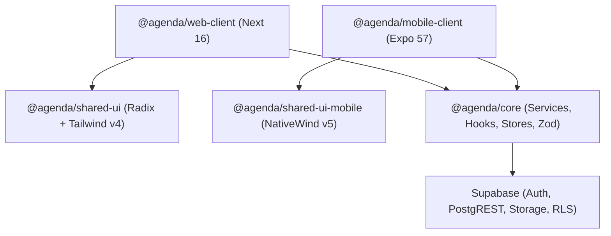

# Análise 1 — Comparativo `web-client` vs `mobile-client` e Planos de Ação

Data: 2026-11-06

## 1. Resultado Executivo

O aplicativo [`package.json`](file:///Users/titorm/git/agenda-de-boteco/apps/mobile-client/package.json#L1-L74) (`@agenda/mobile-client@0.1.0`) já existe no repositório e cobre cerca de 90% das telas de [`package.json`](file:///Users/titorm/git/agenda-de-boteco/apps/web-client/package.json#L1-L41) (`@agenda/web-client@0.0.6`). As lacunas mapeadas anteriormente em `docs/mobile-client-parity.md` (como `CityCombobox`, `AttributeAutocomplete`, `EstablishmentFields`, rota dedicada `/reviews`, `PanelSidebar` e `PanelTopbar`) já foram implementadas; restam bloqueios específicos de runtime nativo, resiliência e CI/CD. O arquivo [`AGENTS.md`](file:///Users/titorm/git/agenda-de-boteco/AGENTS.md#L58-L59) continua defasado ao listar `mobile-client` e `shared-ui-mobile` como planejados.

> [!CAUTION]
> ATENÇÃO: O `mobile-client` falha em produção nativa iOS/Android no login Google OAuth, na recuperação de senha via e-mail e na aprovação da App Store (ausência de Sign in with Apple).

Em contrapartida, o `mobile-client` supera o `web-client` em três pontos:
- Persistência real de preferências de notificações e push no Supabase em [`NotificationsSection.tsx`](file:///Users/titorm/git/agenda-de-boteco/apps/mobile-client/src/components/settings/NotificationsSection.tsx#L89-L143) (o `web-client` usa stub em `localStorage` em [`NotificationsSection.tsx`](file:///Users/titorm/git/agenda-de-boteco/apps/web-client/components/settings/NotificationsSection.tsx#L76-L98)).
- Navegação responsiva para celular e tablet em [`_layout.tsx`](file:///Users/titorm/git/agenda-de-boteco/apps/mobile-client/app/(painel)/_layout.tsx#L83-L107) (o `web-client` oculta a [`Sidebar.tsx`](file:///Users/titorm/git/agenda-de-boteco/apps/web-client/components/Sidebar.tsx#L48) abaixo de `768px` sem menu alternativo).
- Suíte ativa com 7 arquivos de teste Jest contra zero testes no `web-client`.

---

## 2. Arquitetura Compartilhada vs Camada de Apresentação

Toda a regra de negócio do dono de bar já reside testada em `@agenda/core`:
- Vínculo dono↔bar e perfil: [`establishment-owner.ts`](file:///Users/titorm/git/agenda-de-boteco/packages/core/src/services/establishment-owner.ts#L59-L265).
- CRUD e recorrência semanal de eventos: [`owned-events.ts`](file:///Users/titorm/git/agenda-de-boteco/packages/core/src/services/owned-events.ts#L73-L294).
- Upload de imagens e cardápio PDF: [`storage.ts`](file:///Users/titorm/git/agenda-de-boteco/packages/core/src/services/storage.ts#L87-L159).
- Métricas, avaliações, leads de músicos, CEP e push: [`metrics.ts`](file:///Users/titorm/git/agenda-de-boteco/packages/core/src/services/metrics.ts#L64-L162), [`establishment-ratings.ts`](file:///Users/titorm/git/agenda-de-boteco/packages/core/src/services/establishment-ratings.ts#L111-L231), [`musician-leads.ts`](file:///Users/titorm/git/agenda-de-boteco/packages/core/src/services/musician-leads.ts#L86-L125), [`cep.ts`](file:///Users/titorm/git/agenda-de-boteco/packages/core/src/services/cep.ts#L1-L95) e [`push.ts`](file:///Users/titorm/git/agenda-de-boteco/packages/core/src/services/push.ts#L51-L147).

---

## 3. Matriz Comparativa Detalhada (`web-client` vs `mobile-client`)

| Módulo / Funcionalidade | `web-client` | `mobile-client` | Diagnóstico e Ação Necessária |
|---|---|---|---|
| Boas-vindas pública (`/`) | Ausente (cai no guard) | Implementado em [`index.tsx`](file:///Users/titorm/git/agenda-de-boteco/apps/mobile-client/app/index.tsx#L1-L114) | Nenhuma ação no mobile. |
| Login e-mail + senha | Implementado em [`page.tsx`](file:///Users/titorm/git/agenda-de-boteco/apps/web-client/app/login/page.tsx#L128-L145) | Implementado em [`login.tsx`](file:///Users/titorm/git/agenda-de-boteco/apps/mobile-client/app/login.tsx#L141-L159) | Paridade completa. |
| Cadastro OTP + senha + vínculo | Implementado em [`page.tsx`](file:///Users/titorm/git/agenda-de-boteco/apps/web-client/app/login/page.tsx#L163-L217) | Parcial em [`login.tsx`](file:///Users/titorm/git/agenda-de-boteco/apps/mobile-client/app/login.tsx#L201-L216) | CUIDADO: [`handleSignUpVerify`](file:///Users/titorm/git/agenda-de-boteco/apps/mobile-client/app/login.tsx#L209) força `/onboarding` sem checar [`getOwnedEstablishmentId`](file:///Users/titorm/git/agenda-de-boteco/packages/core/src/services/establishment-owner.ts#L94). |
| Login/Cadastro Google OAuth | Implementado (redirect browser) | **Quebrado em nativo** em [`login.tsx`](file:///Users/titorm/git/agenda-de-boteco/apps/mobile-client/app/login.tsx#L242-L249) | Chama [`signInWithOAuth`](file:///Users/titorm/git/agenda-de-boteco/packages/core/src/services/auth.ts#L63-L76) web; portar fluxo `WebBrowser` + `setSession` de [`auth.ts`](file:///Users/titorm/git/agenda-de-boteco/apps/mobile/src/services/auth.ts#L87-L129). |
| Sign in with Apple (iOS) | Ausente | **Ausente** | Obrigatório pela App Store (Guideline 4.8) por existir login social Google. Portar [`signInWithAppleNative`](file:///Users/titorm/git/agenda-de-boteco/apps/mobile/src/services/auth.ts#L50-L80). |
| Recuperação de senha (`/new-password`) | Implementado em [`page.tsx`](file:///Users/titorm/git/agenda-de-boteco/apps/web-client/app/new-password/page.tsx#L1-L78) | **Incompleto em nativo** em [`new-password.tsx`](file:///Users/titorm/git/agenda-de-boteco/apps/mobile-client/app/new-password.tsx#L1-L108) | Faltam `+native-intent.tsx` e [`handleDeepLink`](file:///Users/titorm/git/agenda-de-boteco/apps/mobile/src/services/auth.ts#L131-L150) para capturar tokens do link de e-mail. |
| Onboarding em 3 etapas | Implementado em [`page.tsx`](file:///Users/titorm/git/agenda-de-boteco/apps/web-client/app/onboarding/page.tsx#L1-L191) | Implementado em [`onboarding.tsx`](file:///Users/titorm/git/agenda-de-boteco/apps/mobile-client/app/onboarding.tsx#L1-L215) | Adicionar `trackEvent('establishment_claimed')` no `mobile-client`. |
| Dashboard inicial (`Início`) | Implementado em [`page.tsx`](file:///Users/titorm/git/agenda-de-boteco/apps/web-client/app/(painel)/page.tsx#L1-L142) | Implementado em [`index.tsx`](file:///Users/titorm/git/agenda-de-boteco/apps/mobile-client/app/(painel)/index.tsx#L1-L173) | Nos dois apps o atalho `Métricas` está travado com `disabled: true` ([`index.tsx`](file:///Users/titorm/git/agenda-de-boteco/apps/mobile-client/app/(painel)/index.tsx#L48-L55)); vincular à flag `panel-metrics`. |
| Eventos (lista, rascunho, série, exclusão) | Implementado em [`page.tsx`](file:///Users/titorm/git/agenda-de-boteco/apps/web-client/app/(painel)/events/page.tsx#L1-L162) e [`EventForm.tsx`](file:///Users/titorm/git/agenda-de-boteco/apps/web-client/components/EventForm.tsx#L1-L499) | Implementado em [`index.tsx`](file:///Users/titorm/git/agenda-de-boteco/apps/mobile-client/app/(painel)/events/index.tsx#L1-L308) e [`EventForm.tsx`](file:///Users/titorm/git/agenda-de-boteco/apps/mobile-client/src/components/EventForm.tsx#L1-L403) | Padronizar rota para `item.external_id` e adicionar `trackEvent('event_saved', { isEdit })` no `mobile-client`. |
| Upload de imagens e limpeza | [`ImageDrop.tsx`](file:///Users/titorm/git/agenda-de-boteco/apps/web-client/components/ui/ImageDrop.tsx#L41-L45) remove arquivo antigo | [`ImagePickerField.tsx`](file:///Users/titorm/git/agenda-de-boteco/packages/shared-ui-mobile/src/ImagePickerField.tsx#L59-L95) **não remove antigo** e exibe `err.message` cru (`#L91`) | Chamar [`deleteImage`](file:///Users/titorm/git/agenda-de-boteco/packages/core/src/services/storage.ts#L135) ao substituir/limpar e usar [`getFriendlyErrorMessage`](file:///Users/titorm/git/agenda-de-boteco/packages/core/src/utils/errors.ts#L119). |
| Perfil do bar (CEP, cidade, PDF, horários) | Implementado com `isDirty` em [`page.tsx`](file:///Users/titorm/git/agenda-de-boteco/apps/web-client/app/(painel)/profile/page.tsx#L76-L88) | Implementado **sem `isDirty`** em [`index.tsx`](file:///Users/titorm/git/agenda-de-boteco/apps/mobile-client/app/(painel)/profile/index.tsx#L77-L78) | Adicionar controle `savedDraft`/`isDirty` no `mobile-client`. |
| Artistas (`/artists`), Avaliações (`/reviews`), Métricas (`/metrics`) | Implementados e funcionais | Implementados com `FlashList` e sheets | Paridade funcional completa. |
| Configurações — Notificações | **Stub em `localStorage`** em [`NotificationsSection.tsx`](file:///Users/titorm/git/agenda-de-boteco/apps/web-client/components/settings/NotificationsSection.tsx#L76-L98) | **Real no Supabase + Push** em [`NotificationsSection.tsx`](file:///Users/titorm/git/agenda-de-boteco/apps/mobile-client/src/components/settings/NotificationsSection.tsx#L89-L143) | `mobile-client` mais avançado; portar persistência Supabase para o `web-client`. |
| Realtime, `ErrorBoundary` e `OfflineBanner` | Realtime ativo em [`providers.tsx`](file:///Users/titorm/git/agenda-de-boteco/apps/web-client/app/providers.tsx#L58-L63) | **Ausentes** em [`_layout.tsx`](file:///Users/titorm/git/agenda-de-boteco/apps/mobile-client/app/_layout.tsx#L119-L151) | Portar `useRealtimeSync`, `ErrorBoundary` e `OfflineBanner` de `apps/mobile`. |
| Política de Privacidade (`/privacy`) | Atualizada (`13/10/2026`, 7 seções) em [`page.tsx`](file:///Users/titorm/git/agenda-de-boteco/apps/web-client/app/privacy/page.tsx#L1-L140) | Defasada (`03/09/2026`, 6 seções) em [`privacy.tsx`](file:///Users/titorm/git/agenda-de-boteco/apps/mobile-client/app/privacy.tsx#L1-L122) | Sincronizar seções de Métricas e ViaCEP no `mobile-client`. |
| Build EAS e CI/CD | Deploy Vercel ativo | **Sem `eas.json`**, fora do `ci.yml`/`deploy.yml`, `projectId` só por env em [`app.config.ts`](file:///Users/titorm/git/agenda-de-boteco/apps/mobile-client/app.config.ts#L54) | Criar `eas.json`, fixar `projectId` e integrar workflows. |

---

## 4. Os Três Planos de Ação (Análise 1)

### Plano de Ação 1.1 — Desbloqueio Nativo de Autenticação, Deep Links e Lojas (Prioridade Crítica)

**Objetivo:** Tornar login social, cadastro, recuperação de senha e submissão iOS/Android 100% funcionais no `mobile-client`.

1. Instale `expo-apple-authentication` em [`package.json`](file:///Users/titorm/git/agenda-de-boteco/apps/mobile-client/package.json) (com autorização prévia de dependência) e habilite `ios.usesAppleSignIn: true` + plugin em [`app.config.ts`](file:///Users/titorm/git/agenda-de-boteco/apps/mobile-client/app.config.ts#L15-L49).
2. Crie `apps/mobile-client/src/services/auth.ts` portando [`signInWithProvider`](file:///Users/titorm/git/agenda-de-boteco/apps/mobile/src/services/auth.ts#L87-L129) (`WebBrowser.openAuthSessionAsync` + `skipBrowserRedirect: true` + `setSession`) e [`signInWithAppleNative`](file:///Users/titorm/git/agenda-de-boteco/apps/mobile/src/services/auth.ts#L50-L80) com `scheme: 'agenda-boteco-client'`.
3. Atualize [`login.tsx`](file:///Users/titorm/git/agenda-de-boteco/apps/mobile-client/app/login.tsx#L242-L249) para usar `signInWithProvider('google')` e exibir botão Apple no iOS, preservando [`claimEstablishmentOwner`](file:///Users/titorm/git/agenda-de-boteco/packages/core/src/services/establishment-owner.ts#L76) quando `OAUTH_SIGNUP_KEY` estiver ativa.
4. Corrija [`handleSignUpVerify`](file:///Users/titorm/git/agenda-de-boteco/apps/mobile-client/app/login.tsx#L201-L216): consulte [`getOwnedEstablishmentId`](file:///Users/titorm/git/agenda-de-boteco/packages/core/src/services/establishment-owner.ts#L94) antes de decidir entre `/(painel)` e `/onboarding`.
5. Crie `apps/mobile-client/app/+native-intent.tsx` e `src/utils/deepLinks.ts` (baseados em [`+native-intent.tsx`](file:///Users/titorm/git/agenda-de-boteco/apps/mobile/app/+native-intent.tsx) e [`deepLinks.ts`](file:///Users/titorm/git/agenda-de-boteco/apps/mobile/src/utils/deepLinks.ts)) para interceptar links de recuperação (`type=recovery`), gravar a sessão e abrir [`new-password.tsx`](file:///Users/titorm/git/agenda-de-boteco/apps/mobile-client/app/new-password.tsx).
6. Adicione testes unitários em `apps/mobile-client/src/utils/deepLinks.test.ts` e `src/services/auth.test.ts` cobrindo cancelamento OAuth, tokens inválidos e vínculo dono↔bar.

### Plano de Ação 1.2 — Paridade Funcional, Resiliência Nativa e Higiene de Storage

**Objetivo:** Eliminar todas as divergências de comportamento, UX, privacidade e vazamento de arquivos entre `web-client` e `mobile-client`.

1. Conecte `useRealtimeSync` ([`subscribeToCatalogChanges`](file:///Users/titorm/git/agenda-de-boteco/packages/core/src/services/realtime.ts#L1)), `ErrorBoundary` e `OfflineBanner` no topo de [`_layout.tsx`](file:///Users/titorm/git/agenda-de-boteco/apps/mobile-client/app/_layout.tsx#L119-L151).
2. Corrija o duplo feedback de erro em [`bootstrap.ts`](file:///Users/titorm/git/agenda-de-boteco/apps/mobile-client/src/lib/bootstrap.ts#L17-L19): substitua o `Alert.alert` global de mutação pelo sistema de toast ou restrinja o handler global a erros não tratados localmente.
3. Atualize [`ImagePickerField.tsx`](file:///Users/titorm/git/agenda-de-boteco/packages/shared-ui-mobile/src/ImagePickerField.tsx#L88-L92) para excluir a URL anterior via [`deleteImage`](file:///Users/titorm/git/agenda-de-boteco/packages/core/src/services/storage.ts#L135) após novo upload ou remoção, e substitua `err.message` por [`getFriendlyErrorMessage`](file:///Users/titorm/git/agenda-de-boteco/packages/core/src/utils/errors.ts#L119).
4. Adicione controle `savedDraft` / `isDirty` em [`index.tsx`](file:///Users/titorm/git/agenda-de-boteco/apps/mobile-client/app/(painel)/profile/index.tsx#L77-L78) e exiba `logo_url` na [`PanelTopbar.tsx`](file:///Users/titorm/git/agenda-de-boteco/apps/mobile-client/src/components/PanelTopbar.tsx#L28-L33).
5. Substitua o bloqueio fixo `disabled: true` do card `Métricas` em [`index.tsx`](file:///Users/titorm/git/agenda-de-boteco/apps/mobile-client/app/(painel)/index.tsx#L48-L55) (e em [`page.tsx`](file:///Users/titorm/git/agenda-de-boteco/apps/web-client/app/(painel)/page.tsx#L37-L44)) pela leitura de `useFeatureFlag('panel-metrics')`.
6. Padronize a navegação de edição em [`index.tsx`](file:///Users/titorm/git/agenda-de-boteco/apps/mobile-client/app/(painel)/events/index.tsx#L199) para `item.external_id`, dispare `trackEvent('establishment_claimed')` em [`onboarding.tsx`](file:///Users/titorm/git/agenda-de-boteco/apps/mobile-client/app/onboarding.tsx#L101) e `trackEvent('event_saved', { isEdit })` em [`EventForm.tsx`](file:///Users/titorm/git/agenda-de-boteco/apps/mobile-client/src/components/EventForm.tsx), e sincronize o texto de [`privacy.tsx`](file:///Users/titorm/git/agenda-de-boteco/apps/mobile-client/app/privacy.tsx) com a versão de `13/10/2026`.

### Plano de Ação 1.3 — Infraestrutura de Release do `mobile-client` e Paridade Reversa no `web-client`

**Objetivo:** Preparar o `mobile-client` para build/loja automatizados e levar ao `web-client` os avanços que só existem hoje no mobile.

1. Crie `apps/mobile-client/eas.json` espelhando perfis `development`, `alfa`, `beta` e `production` de [`eas.json`](file:///Users/titorm/git/agenda-de-boteco/apps/mobile/eas.json#L1-L55), fixando o UUID de `extra.eas.projectId` em [`app.config.ts`](file:///Users/titorm/git/agenda-de-boteco/apps/mobile-client/app.config.ts#L50-L56).
2. Descomente/adicione `apps/mobile-client/ios/` e `apps/mobile-client/android/` no [`.gitignore`](file:///Users/titorm/git/agenda-de-boteco/.gitignore#L93-L94) para manter CNG limpo, e alinhe os patches de `expo` (`~57.0.26`) e `expo-router` (`~57.0.24`) entre `mobile` e `mobile-client`.
3. Estenda [`scripts/build-mobile.bash`](file:///Users/titorm/git/agenda-de-boteco/scripts/build-mobile.bash#L1-L32), [`ci.yml`](file:///Users/titorm/git/agenda-de-boteco/.github/workflows/ci.yml#L35-L82), [`version-gate.yml`](file:///Users/titorm/git/agenda-de-boteco/.github/workflows/version-gate.yml#L35-L82) e [`deploy.yml`](file:///Users/titorm/git/agenda-de-boteco/.github/workflows/deploy.yml#L170-L177) para suportar matriz ou filtro independente de `@agenda/mobile` e `@agenda/mobile-client`.
4. No `web-client`, substitua o stub `localStorage` de [`NotificationsSection.tsx`](file:///Users/titorm/git/agenda-de-boteco/apps/web-client/components/settings/NotificationsSection.tsx#L76-L98) por [`getNotificationPreferences`](file:///Users/titorm/git/agenda-de-boteco/packages/core/src/services/push.ts#L97) e [`saveNotificationPreferences`](file:///Users/titorm/git/agenda-de-boteco/packages/core/src/services/push.ts#L123) para sincronizar preferências entre web e app.
5. No `web-client`, adicione drawer mobile na [`Topbar.tsx`](file:///Users/titorm/git/agenda-de-boteco/apps/web-client/components/Topbar.tsx) para telas `<768px` e remova os componentes mortos [`ComingSoon.tsx`](file:///Users/titorm/git/agenda-de-boteco/apps/web-client/components/ComingSoon.tsx) e [`SubscriptionSection.tsx`](file:///Users/titorm/git/agenda-de-boteco/apps/web-client/components/settings/SubscriptionSection.tsx).
