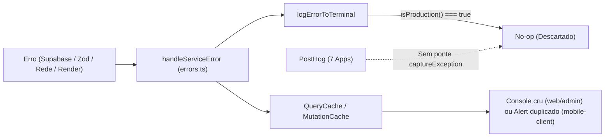

# Análise 2 — PostHog Proativo, Error Tracking e Observabilidade (Zero-PII)

Data: 2026-11-06

## 1. Resultado Executivo

Os 7 apps ativos do monorepo (5 Next.js com `posthog-js@1.425.1` e 2 Expo com `posthog-react-native@4.66.3`) já instalam o SDK e enviam pageviews/screens básicos. Porém, **100% dos erros de serviço, falhas de banco/RLS, quebras de contrato Zod, crashes nativos e erros de renderização passam despercebidos em produção hoje**.

> [!CAUTION]
> ATENÇÃO: Conectar a captura de erros sem higienização prévia violará SOC 2 e LGPD. Há códigos OTP, e-mails, tokens JWT de OAuth e coordenadas exatas em `ErrorContext.args`, URLs de callback e inputs DOM.

---

## 2. Diagnóstico Atual por Camada e Aplicativo

### 2.1. Lacunas que Impedem Detecção Proativa Hoje

| Ponto de Falha | Evidência no Código | Impacto em Produção |
|---|---|---|
| Ponte de erro ausente no Core | [`analytics.ts`](file:///Users/titorm/git/agenda-de-boteco/packages/core/src/services/analytics.ts#L12-L20) não tem `captureException`; [`logErrorToTerminal`](file:///Users/titorm/git/agenda-de-boteco/packages/core/src/utils/errors.ts#L78-L81) retorna vazio em produção | Zero eventos `$exception` enviados ao PostHog em falhas de API, Auth, RLS ou Zod. |
| Mobile `errorTracking` desligado | [`analytics.ts`](file:///Users/titorm/git/agenda-de-boteco/apps/mobile/src/lib/analytics.ts#L18) e [`analytics.ts`](file:///Users/titorm/git/agenda-de-boteco/apps/mobile-client/src/lib/analytics.ts#L18) instanciam `new PostHog(key, { host })` sem `errorTracking.autocapture` | No `posthog-react-native@4.66.3`, listeners `ErrorUtils` e `unhandledRejections` ficam desativados mesmo se ligados no painel web. |
| Crashes nativos e Source Maps ausentes | Sem `@posthog/react-native-plugin`, sem `getPostHogExpoConfig` nos `metro.config.js`, sem `@posthog/nextjs-config` nos `next.config.ts` e sem upload em [`deploy.yml`](file:///Users/titorm/git/agenda-de-boteco/.github/workflows/deploy.yml#L112-L185) | Crashes C++/Kotlin/Swift somem; stack traces JS/Hermes chegam minificados e ilegíveis. |
| Ausência de Error Boundaries | Zero arquivos `error.tsx`/`global-error.tsx` nos 5 apps Next; `mobile-client` sem boundary em [`_layout.tsx`](file:///Users/titorm/git/agenda-de-boteco/apps/mobile-client/app/_layout.tsx#L119-L151); [`ErrorBoundary.tsx`](file:///Users/titorm/git/agenda-de-boteco/apps/mobile/src/components/ErrorBoundary.tsx#L22-L24) do `mobile` só faz `console.error` | Tela branca ou fallback genérico sem registro no PostHog. |
| Bloqueio por Adblockers na Web | Nenhum rewrite `/ingest` nos 5 `next.config.ts` nem em [`vercel.json`](file:///Users/titorm/git/agenda-de-boteco/apps/landing/vercel.json#L1-L37); faltam headers CSP em [`next.config.ts`](file:///Users/titorm/git/agenda-de-boteco/apps/web-client/next.config.ts#L1-L30) e [`next.config.ts`](file:///Users/titorm/git/agenda-de-boteco/apps/web-artists/next.config.ts#L1-L15) | Perda de 20–40% de eventos/erros web e falha de carregamento das feature flags `panel-*`. |
| Colisão de URLs e Identidade Web | [`analytics.ts`](file:///Users/titorm/git/agenda-de-boteco/packages/core/src/services/analytics.ts#L82) envia `$current_url: path` sem domínio e sem `basePath`; web nunca chama `resetAnalytics()` no logout e não re-identifica sessão persistida | Pageviews de `/client`, `/app`, `/admin` e `/` colidem; sessões anônimas/pós-logout se misturam. |
| Quebra total por `ZodError` silencioso | [`catalog.ts`](file:///Users/titorm/git/agenda-de-boteco/packages/core/src/queries/catalog.ts#L245-L498) e [`proximity.ts`](file:///Users/titorm/git/agenda-de-boteco/packages/core/src/services/proximity.ts#L157) dão `.parse()` na lista inteira | Um único registro inválido no banco derruba o feed inteiro sem alertar a engenharia. |
| Bug de `NetworkError` nos Browsers | [`errors.ts`](file:///Users/titorm/git/agenda-de-boteco/packages/core/src/utils/errors.ts#L42-L44) testa apenas `'Network request failed'` (texto exclusivo do React Native) | Chrome (`Failed to fetch`), Safari (`Load failed`) e Firefox caem como `UnknownError` na web. |
| Serviços fora do padrão de erro | [`favorites.ts`](file:///Users/titorm/git/agenda-de-boteco/packages/core/src/services/favorites.ts#L33-L116), [`useFavoritesStore.ts`](file:///Users/titorm/git/agenda-de-boteco/packages/core/src/stores/useFavoritesStore.ts#L79-L81), [`storage.ts`](file:///Users/titorm/git/agenda-de-boteco/packages/core/src/services/storage.ts#L71-L115) e [`realtime.ts`](file:///Users/titorm/git/agenda-de-boteco/packages/core/src/services/realtime.ts#L107-L115) | Rejeições de Promise não tratadas, fila offline presa em loop e queda invisível de WebSocket. |

### 2.2. Riscos Críticos de Vazamento de PII / Credenciais (SOC 2)

1. **OTP e e-mail em `ErrorContext.args`:** [`auth.ts`](file:///Users/titorm/git/agenda-de-boteco/packages/core/src/services/auth.ts#L89-L148) passa `{ email }` em 5 métodos e `{ email, token }` (código OTP!) na linha `#L105`.
2. **JWT de sessão em `ErrorContext.args`:** [`auth.ts`](file:///Users/titorm/git/agenda-de-boteco/apps/mobile/src/services/auth.ts#L145) passa `args: { url }` contendo `#access_token=...&refresh_token=...`.
3. **Tokens OAuth em `$current_url` no Browser:** `detectSessionInUrl: true` deixa tokens no hash/query da URL durante o callback; `posthog-js` captura `window.location.href` se `before_send` não limpar hash e parâmetros sensíveis.
4. **Coordenadas exatas em exceção:** [`proximity.ts`](file:///Users/titorm/git/agenda-de-boteco/packages/core/src/services/proximity.ts#L49) interpola `lat`/`lng` na string de `Error` e em `args` (`#L161`).
5. **Autocapture DOM e Session Replay:** `autocapture: true` está ativo hoje nos 5 apps web sobre inputs de OTP (`type="text"`) e telas que exibem e-mail/WhatsApp/CPF/CNPJ, sem `maskAllInputs: true` forçado em código.

---

## 3. Os Três Planos de Ação (Análise 2)

### Plano de Ação 2.1 — Blindagem Zero-PII e Captura Central de Exceções em Todos os Apps

**Objetivo:** Higienizar 100% dos vetores de PII/credenciais e conectar toda a árvore de serviços, queries e UI ao PostHog Error Tracking.

1. Remova `email` e `token` de `args` em [`auth.ts`](file:///Users/titorm/git/agenda-de-boteco/packages/core/src/services/auth.ts#L89-L148), remova `url` de `args` em [`auth.ts`](file:///Users/titorm/git/agenda-de-boteco/apps/mobile/src/services/auth.ts#L145) e arredonde/omita `lat`/`lng` em [`proximity.ts`](file:///Users/titorm/git/agenda-de-boteco/packages/core/src/services/proximity.ts#L49-L161).
2. Estenda [`AnalyticsAdapter`](file:///Users/titorm/git/agenda-de-boteco/packages/core/src/services/analytics.ts#L12-L20) com `captureException(error: unknown, metadata?: SafeErrorMetadata): void`, aceitando apenas metadados estruturais (`method`, `errorType`, `code`, `app`, `status`) — nunca `ErrorContext.args` bruto nem `PostgrestError.details` com valores violados.
3. Configure [`createPostHogBrowserAdapter`](file:///Users/titorm/git/agenda-de-boteco/packages/core/src/services/analytics.ts#L69-L89) com `capture_exceptions: { capture_unhandled_errors: true, capture_unhandled_rejections: true, capture_console_errors: false }`, `persistence: 'localStorage'`, `session_recording: { maskAllInputs: true, maskTextSelector: '[data-ph-mask]' }`, e hook `before_send` que remove `#access_token`, `refresh_token`, `code` e `token` de qualquer URL, além de corrigir `$current_url` com `window.location.origin + basePath + pathname`.
4. Conecte [`handleServiceError`](file:///Users/titorm/git/agenda-de-boteco/packages/core/src/utils/errors.ts#L161-L164) ao `captureException` (ignorando `AbortError` e erros esperados de credencial inválida `invalid_credentials` / `otp_expired`, para evitar ruído de erro do usuário).
5. Corrija [`getErrorType`](file:///Users/titorm/git/agenda-de-boteco/packages/core/src/utils/errors.ts#L32-L49) e [`getFriendlyErrorMessage`](file:///Users/titorm/git/agenda-de-boteco/packages/core/src/utils/errors.ts#L119-L159) para reconhecer `Failed to fetch` / `Load failed` como `NetworkError`, mapear `StorageError`, `UnsupportedFileTypeError` e `AuthUnavailableError`, e remover `console.error` cru em [`providers.tsx`](file:///Users/titorm/git/agenda-de-boteco/apps/web/app/providers.tsx#L45) e [`providers.tsx`](file:///Users/titorm/git/agenda-de-boteco/apps/admin/app/providers.tsx#L38).
6. Crie `app/error.tsx` e `app/global-error.tsx` nos 5 apps Next.js reportando ao `captureException`, mova [`ErrorBoundary.tsx`](file:///Users/titorm/git/agenda-de-boteco/apps/mobile/src/components/ErrorBoundary.tsx#L15-L46) para `@agenda/shared-ui-mobile` reportando `componentStack` ao PostHog e envolva o topo de `apps/mobile` e `apps/mobile-client`.

### Plano de Ação 2.2 — Source Maps, Crash Nativo Mobile, Reverse Proxy e Identidade Unificada

**Objetivo:** Garantir que todo stack trace em produção aponte arquivo e linha exatos do TypeScript, sem perda por adblockers nem sessões quebradas.

1. Nos 5 apps Next.js, adicione rewrites de Reverse Proxy (`/ingest/static/:path*` e `/ingest/:path*` apontando para o host do PostHog) em cada `next.config.ts` e adicione headers CSP faltantes em [`next.config.ts`](file:///Users/titorm/git/agenda-de-boteco/apps/web-client/next.config.ts) e [`next.config.ts`](file:///Users/titorm/git/agenda-de-boteco/apps/web-artists/next.config.ts).
2. Integre `@posthog/nextjs-config` (`withPostHogConfig`) nos 5 `next.config.ts` para gerar, enviar e deletar source maps públicos durante o build de produção, vinculando `releaseName` (`@agenda/web`, `@agenda/web-client`, etc.) e `releaseVersion` (`GIT_COMMIT_SHA` / `package.json`).
3. Unifique o bootstrap PostHog mobile em `@agenda/shared-ui-mobile` (ou helper dedicado) configurando `personProfiles: 'identified_only'` e `errorTracking: { autocapture: { uncaughtExceptions: true, unhandledRejections: true, console: [], nativeCrashes: true } }`.
4. Instale `@posthog/react-native-plugin` (com aprovação prévia), envolva `metro.config.js` de `mobile` e `mobile-client` com `getPostHogExpoConfig` (compondo com `withNativewind`) e adicione upload de símbolos Hermes/dSYM/Proguard em [`deploy.yml`](file:///Users/titorm/git/agenda-de-boteco/.github/workflows/deploy.yml) via `POSTHOG_CLI_TOKEN` no GitHub Secrets/EAS.
5. Corrija o ciclo de identidade nos apps web (`web`, `web-client`, `admin`): sincronize `onAuthUserChange` no `providers.tsx` (idêntico a [`_layout.tsx`](file:///Users/titorm/git/agenda-de-boteco/apps/mobile-client/app/_layout.tsx#L58-L75)) para identificar sessões persistidas via `external_id` e executar `resetAnalytics()` em todo `signOut` e exclusão de conta.

### Plano de Ação 2.3 — Telemetria de Degradação Silenciosa, Saúde de Dados e Alertas Proativos

**Objetivo:** Detectar registros corrompidos, quedas de Realtime, filas travadas e anomalias de conversão no minuto em que ocorrerem, antes de qualquer reclamação.

1. Troque o `.parse()` bloqueante de lista em [`catalog.ts`](file:///Users/titorm/git/agenda-de-boteco/packages/core/src/queries/catalog.ts#L245-L498), [`proximity.ts`](file:///Users/titorm/git/agenda-de-boteco/packages/core/src/services/proximity.ts#L157) e [`musician-leads.ts`](file:///Users/titorm/git/agenda-de-boteco/packages/core/src/services/musician-leads.ts#L111) por validação item-a-item com `safeParse`: descarte apenas a linha corrompida (mantendo o app de pé para o usuário) e envie imediatamente `captureException` com `$exception_fingerprint: ['zod-schema-drift', table, issuePath]` e o `external_id` do registro problemático.
2. Padronize `handleServiceError` em [`favorites.ts`](file:///Users/titorm/git/agenda-de-boteco/packages/core/src/services/favorites.ts#L33-L116), [`storage.ts`](file:///Users/titorm/git/agenda-de-boteco/packages/core/src/services/storage.ts#L71-L115) e [`metrics.ts`](file:///Users/titorm/git/agenda-de-boteco/packages/core/src/services/metrics.ts#L70-L129); limite tentativas na fila offline de [`useFavoritesStore.ts`](file:///Users/titorm/git/agenda-de-boteco/packages/core/src/stores/useFavoritesStore.ts#L79-L81) (descartando erro 4xx/RLS com `captureException`) e reporte `CHANNEL_ERROR`/`TIMED_OUT` recorrentes em [`realtime.ts`](file:///Users/titorm/git/agenda-de-boteco/packages/core/src/services/realtime.ts#L107-L115) como evento `realtime_degraded`.
3. Instrumente propriedades super (`register({ app_name, app_version, channel, platform })`) para filtrar regressões por release/OTA imediatamente.
4. Configure no painel PostHog (**Error Tracking → Alerting**) três gatilhos automáticos enviados para Slack/Discord/Webhook:
   - **Issue Created:** disparo imediato quando surgir qualquer erro inédito em `production` ou `alfa`.
   - **Issue Reopened:** disparo imediato se um bug marcado como resolvido voltar em nova versão.
   - **Spike Alert + Threshold Insight:** disparo quando o volume de `$exception`, `zod-schema-drift`, falha de upload (`storage.*`) ou `realtime_degraded` ultrapassar o baseline em janela de 5 minutos.
5. Habilite **Session Replay condicional por erro** (buffer em memória gravado apenas quando `$exception` dispara, com `maskAllInputs: true` e `maskAllImages: true` no mobile) e conecte o servidor MCP oficial do PostHog no IDE para inspecionar stack traces e sessões diretamente na correção.
