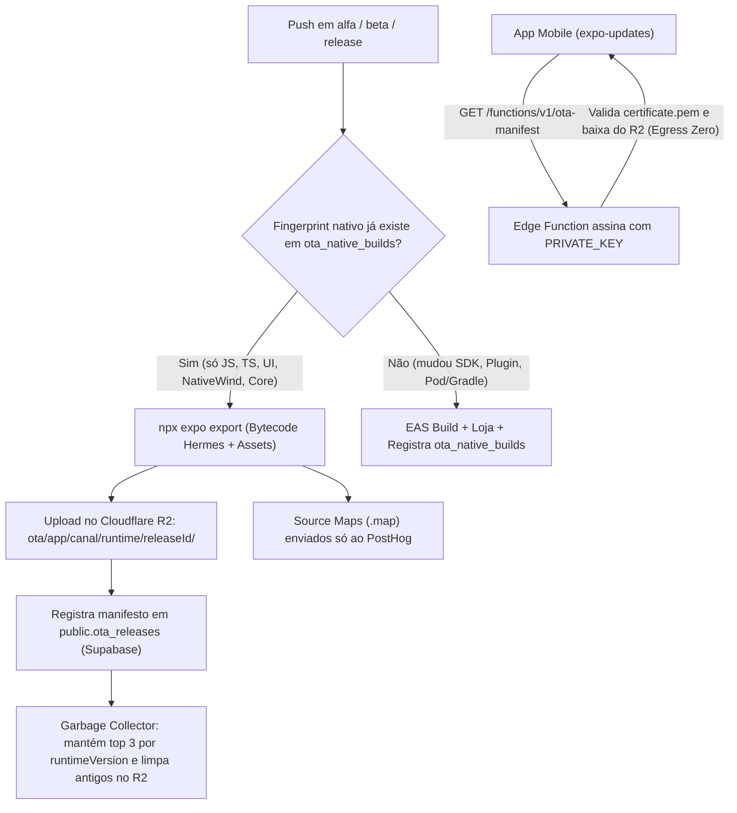

# Análise 3 — Deploy Over-The-Air (OTA) Mobile com Cloudflare R2 e Limpeza Automática

Data: 2026-11-07

## 1. Resultado Executivo

O deploy Over-The-Air (OTA) para [`@agenda/mobile`](file:///Users/titorm/git/agenda-de-boteco/apps/mobile/package.json#L1-L81) (`0.3.0`) e [`@agenda/mobile-client`](file:///Users/titorm/git/agenda-de-boteco/apps/mobile-client/package.json#L1-L74) (`0.1.0`) será implementado com **`expo-updates` oficial (MIT) + Cloudflare R2 + Supabase Edge Function**, operando a **custo \$0/mês**, sem limite de MAUs e com **Code Signing RSA-SHA256 gratuito**. Com retenção automática ativa, o consumo estabiliza em **~300 MB** (bem abaixo do teto planejado de **2 GB** e dos **10 GB gratuitos** do R2).

> [!WARNING]
> CUIDADO: Dois pontos atuais do repositório exigem ajuste junto do OTA: (1) usar `runtimeVersion` baseado em `fingerprint` para não conflitar com o bump obrigatório do [`version-gate.yml`](file:///Users/titorm/git/agenda-de-boteco/.github/workflows/version-gate.yml#L79-L82); (2) injetar `EXPO_PUBLIC_*` no `npx expo export` do CI para não cair em dados mock nem desligar flags `panel-*`.

---

## 2. Arquitetura Proposta (`expo-updates` + Cloudflare R2 + Auto-Prune)

### 2.1. O que Vai por OTA vs O que Exige Build de Loja

| Alteração no Repositório | Vai por OTA? | Motivo Técnico |
|---|---|---|
| Telas, rotas Expo Router, hooks e services de `@agenda/core` / `@agenda/shared-ui-mobile` | **Sim** | Código TypeScript compilado em bytecode Hermes (`.hbc`). |
| Novas classes Tailwind v4 / NativeWind v5 | **Sim** | O patch [`react-native-css@0.0.0-nightly.5ce6396.patch`](file:///Users/titorm/git/agenda-de-boteco/patches/react-native-css@0.0.0-nightly.5ce6396.patch#L1-L63) roda no Metro e gera JS puro. |
| Textos pt-BR e ícones/imagens importados em JS ([`assets`](file:///Users/titorm/git/agenda-de-boteco/apps/mobile/assets) = 564 KB) | **Sim** | Assets empacotados no prefixo da release no R2. |
| Mudança em `app.config.ts` (permissões, `scheme`, ícone nativo, chaves Maps, certificado) | **Não (Exige Loja)** | Altera `Info.plist` / `AndroidManifest.xml` no binário compilado. |
| Instalar ou atualizar lib nativa (`react-native-maps`, `reanimated`, `worklets`, `expo-*`) | **Não (Exige Loja)** | Altera código nativo C++/Swift/Kotlin e gera novo `fingerprint`. |

---

## 3. Dimensionamento no Cloudflare R2 e Automação de Limpeza (< 2 GB)

### 3.1. Layout de Pastas Isolado por Release (Zero Risco de Órfãos)
Cada deploy grava um pacote autocontido (sem pasta `assets/` global compartilhada) e **exclui arquivos `.map`**:
`ota/<app_slug>/<channel>/<runtime_version>/<release_id>/{bundles/*, assets/*}`

- **Tamanho real por deploy (Android + iOS):** **5,5 MB a 9,5 MB** (~4–8 MB de `.hbc` + ~1,5 MB de fontes/ícones).
- **Duas camadas automáticas de limpeza** mantêm o bucket permanentemente enxuto:

| Camada de Limpeza | Escopo no Bucket R2 | Regra Automática | Consumo Estável |
|---|---|---|---|
| **1. R2 Object Lifecycle Rule** | `ota/*/alfa/*` e `ota/*/beta/*` | Expiração nativa gratuita da Cloudflare em **30 dias** (zero chamadas de API). | **~100 a 150 MB** |
| **2. Script GC (`prune-ota-releases.mjs`)** | `ota/*/production/*` | Roda após cada deploy e em cron mensal: mantém as **últimas 3 releases** (`ativa`, `N-1`, `N-2`) de cada `runtime_version` ativo e apaga `N-3+` no R2; remove `runtime_version` aposentados há > 90 dias sem uso. | **~150 MB** (2 apps × 3 runtimes × 3 releases) |
| **Total em Regime Permanente** | Bucket `agenda-ota` inteiro | **~250 a 300 MB ocupados** (**< 15% da reserva de 2 GB** e custo **\$0/mês**). | **Folga > 1,7 GB** |

> [!IMPORTANT]
> O Garbage Collector nunca apaga a última release ativa de um `runtime_version` que ainda possua usuários nas lojas. Isso garante que usuários em binários anteriores recebam sempre o último hotfix compatível.

---

## 4. Análise Completa de Impactos

### 4.1. Conformidade Apple App Store e Google Play
- **Apple Guideline 2.5.2 e Google Play:** permitem bundles JS/Hermes interpretados via `expo-updates` para correções de bugs, ajustes visuais e melhorias incrementais, desde que não alterem o propósito aprovado do app nem burlem pagamentos nativos.

### 4.2. Impacto em UX (Cold Start) e Segurança (SOC 2)
- **Zero bloqueio na abertura:** com `checkAutomatically: 'ON_LOAD'` e `fallbackToCacheTimeout: 0`, o app abre imediatamente, baixa o bundle do R2 em background no 1º uso e aplica no 2º uso (com opção manual `"Verificar atualização"` nas Configurações).
- **End-to-End Code Signing gratuito:** a Edge Function assina o manifesto com `PRIVATE_KEY` (`expo-signature`), e o `expo-updates` valida contra `./certs/certificate.pem` embutido no binário. Mesmo se o bucket público R2 sofresse tentativa de adulteração, o aparelho rejeitaria o bundle.

### 4.3. Impacto em Banco de Dados, Cache Local e Contratos Zod
- **Migrações aditivas:** como [`deploy.yml`](file:///Users/titorm/git/agenda-de-boteco/.github/workflows/deploy.yml#L86-L111) aplica `supabase db push` antes de 100% dos clientes baixarem o OTA, toda mudança SQL deve ser retrocompatível (*expand-and-contract*).
- **Resiliência Zod e Cache:** enums estritos em [`catalog.ts`](file:///Users/titorm/git/agenda-de-boteco/packages/core/src/schemas/catalog.ts#L23-L156) precisam de fallback seguro para novos valores do banco; mudanças em shapes persistidos exigem incrementar [`CACHE_BUSTER`](file:///Users/titorm/git/agenda-de-boteco/packages/core/src/services/cachePolicy.ts#L16) e versionar as stores [`usePreferencesStore.ts`](file:///Users/titorm/git/agenda-de-boteco/packages/core/src/stores/usePreferencesStore.ts#L47), [`useFavoritesStore.ts`](file:///Users/titorm/git/agenda-de-boteco/packages/core/src/stores/useFavoritesStore.ts#L112) e [`useNotificationsStore.ts`](file:///Users/titorm/git/agenda-de-boteco/packages/core/src/stores/useNotificationsStore.ts#L26).

---

## 5. Os Três Planos de Ação (Análise 3 — Proposta Cloudflare R2)

### Plano de Ação 3.1 — Fundação `expo-updates`, Bucket R2, Edge Function e Code Signing

**Objetivo:** Habilitar o protocolo oficial Expo Updates v1 nos dois apps apontando para o Supabase + Cloudflare R2 com assinatura criptográfica ponta a ponta.

1. Gere o par de chaves RSA (`npx expo-updates codesigning:generate`), versione apenas `certificate.pem` em `apps/mobile/certs/` e `apps/mobile-client/certs/`, e salve `OTA_PRIVATE_KEY` nos Secrets do Supabase e GitHub Actions.
2. Instale `expo-updates` em [`apps/mobile/package.json`](file:///Users/titorm/git/agenda-de-boteco/apps/mobile/package.json) e [`apps/mobile-client/package.json`](file:///Users/titorm/git/agenda-de-boteco/apps/mobile-client/package.json) (com autorização prévia) e alinhe as versões patch de `expo` e `expo-router`.
3. Configure `runtimeVersion: { policy: 'fingerprint' }`, `updates.url` apontando para `https://<project-ref>.supabase.co/functions/v1/ota-manifest`, `updates.codeSigningCertificate` e `updates.requestHeaders` (`expo-channel-name` + `x-app-slug`) em [`apps/mobile/app.config.ts`](file:///Users/titorm/git/agenda-de-boteco/apps/mobile/app.config.ts) e [`apps/mobile-client/app.config.ts`](file:///Users/titorm/git/agenda-de-boteco/apps/mobile-client/app.config.ts), além de `"channel"` em [`apps/mobile/eas.json`](file:///Users/titorm/git/agenda-de-boteco/apps/mobile/eas.json) e `apps/mobile-client/eas.json`.
4. Crie `fingerprint.config.js` em ambos os apps ignorando arquivos não nativos (`CHANGELOG-*.md`, `docs/`, testes, apps web) e corrija [`getEnvVar`](file:///Users/titorm/git/agenda-de-boteco/apps/mobile/app.config.ts#L6-L15) para validar `alfa` e `beta`.
5. Crie migração SQL com as tabelas `public.ota_native_builds` e `public.ota_releases` (com `ENABLE ROW LEVEL SECURITY` e escrita exclusiva via `service_role`) e implemente a Edge Function `supabase/functions/ota-manifest/index.ts` assinando o manifesto e retornando `204` quando o cliente já estiver atualizado.
6. Provisione o bucket `agenda-ota` no Cloudflare R2 com domínio customizado/CDN (`Cache-Control: public, max-age=31536000, immutable`).

### Plano de Ação 3.2 — Pipeline CI/CD Automatizado + Garbage Collector de Versões Antigas no R2

**Objetivo:** Publicar OTA no R2 em ~60 segundos quando o fingerprint coincidir e executar automaticamente a limpeza de versões antigas mantendo o uso sempre abaixo de 2 GB.

1. Configure a regra nativa de *Object Lifecycle* no bucket Cloudflare R2 (`scripts/setup-r2-lifecycle.mjs`) expirando automaticamente os prefixos `ota/*/alfa/` e `ota/*/beta/` após **30 dias**.
2. Amplie o detector de mudanças em [`ci.yml`](file:///Users/titorm/git/agenda-de-boteco/.github/workflows/ci.yml#L35-L82) para monitorar `apps/mobile/**`, `apps/mobile-client/**`, `packages/core/**` e `packages/shared-ui-mobile/**`.
3. Crie `scripts/publish-ota-r2.mjs` e integre ao [`deploy.yml`](file:///Users/titorm/git/agenda-de-boteco/.github/workflows/deploy.yml#L163-L177):
   - Calcula `npx @expo/fingerprint` do app; se não existir em `ota_native_builds` para o canal, dispara `eas build` e grava o novo fingerprint.
   - Se o fingerprint já existir, executa `npx expo export --dump-sourcemap` com as variáveis `EXPO_PUBLIC_*` do canal, envia `.map` apenas ao PostHog (`posthog-cli hermes upload`), faz upload de `.hbc` + assets para `ota/<app>/<canal>/<runtime>/<releaseId>/` no R2 e grava a release ativa em `ota_releases`.
4. Crie `scripts/prune-ota-releases.mjs` (chamado ao fim de todo `publish-ota-r2.mjs` e em workflow agendado mensal `.github/workflows/ota-gc.yml`):
   - Agrupa `public.ota_releases` por `(app_slug, channel, runtime_version)` ordenado por `created_at DESC`.
   - Mantém intocadas as **top 3 releases** de cada `runtime_version` ativo (atual + 2 anteriores para rollback imediato).
   - Remove em lote no Cloudflare R2 (`DeleteObjectsCommand`) todos os objetos das releases `4..N` superadas e de `runtime_version` aposentados há > 90 dias sem tráfego, gravando `pruned_at` no banco e emitindo alerta se o uso total do bucket ultrapassar **1,5 GB** (75% da cota de 2 GB).

### Plano de Ação 3.3 — Governança Anti-Quebra (Rollback Instantâneo, Telemetria e Contratos)

**Objetivo:** Permitir reversão em segundos sem re-upload, rastrear cada update no PostHog e proteger clientes ainda não atualizados.

1. Crie `scripts/rollback-ota.mjs` (`pnpm ota:rollback --app <slug> --channel production`): promove de volta a release `N-1` já armazenada no R2 (ou emite diretiva `rollbackToEmbedded` do protocolo Expo Updates v1) em **menos de 2 segundos**, sem recompilar código.
2. Crie helper `src/lib/updates.ts` nos dois apps mobile registrando `Updates.updateId`, `Updates.channel` e `Updates.runtimeVersion` no PostHog e expondo botão `"Verificar atualizações"` na tela de Configurações.
3. Adicione `version` e `migrate` nas stores persistidas ([`usePreferencesStore.ts`](file:///Users/titorm/git/agenda-de-boteco/packages/core/src/stores/usePreferencesStore.ts#L47), [`useFavoritesStore.ts`](file:///Users/titorm/git/agenda-de-boteco/packages/core/src/stores/useFavoritesStore.ts#L112), [`useNotificationsStore.ts`](file:///Users/titorm/git/agenda-de-boteco/packages/core/src/stores/useNotificationsStore.ts#L26)) junto da verificação de [`CACHE_BUSTER`](file:///Users/titorm/git/agenda-de-boteco/packages/core/src/services/cachePolicy.ts#L16).
4. Adicione fallback resiliente nos schemas de leitura em [`catalog.ts`](file:///Users/titorm/git/agenda-de-boteco/packages/core/src/schemas/catalog.ts#L23-L156) para tolerar novos enums adicionados em migrações SQL enquanto clientes antigos aguardam o próximo ciclo de OTA.
