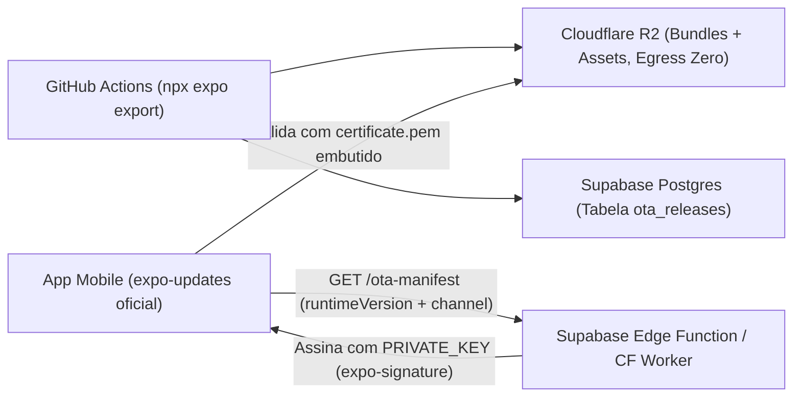

# Análise 3B — Alternativas Gratuitas e de Baixo Custo ao EAS Update (OTA Mobile)

Data: 2026-11-06
Complemento de: [`analise-3-deploy-ota-mobile.md`](file:///Users/titorm/git/agenda-de-boteco/docs/analise-3-deploy-ota-mobile.md)

## 1. Resultado Executivo

É possível eliminar 100% da cobrança por usuário ativo (MAU) e obter **End-to-End Code Signing gratuito** para [`@agenda/mobile`](file:///Users/titorm/git/agenda-de-boteco/apps/mobile/package.json#L1-L81) e [`@agenda/mobile-client`](file:///Users/titorm/git/agenda-de-boteco/apps/mobile-client/package.json#L1-L74) no Expo SDK 57 + React Native 0.86.3 (New Architecture + Hermes).

> [!TIP]
> A melhor relação custo × segurança × manutenção para este monorepo é manter o cliente oficial **`expo-updates`** (licença MIT) apontando `updates.url` para um endpoint próprio (Supabase Edge Function ou XPREM) + **Cloudflare R2** (taxa zero de transferência).

---

## 2. Matriz Comparativa de Mercado (2026)

| Solução | Modelo | Custo Mensal | Limite de MAUs | Módulo Nativo no App | Code Signing E2E | Bundle Diffing (Delta) |
|---|---|---|---|---|---|---|
| **EAS Update (Referência)** | SaaS Expo | \$0 → \$19 → \$199+ | 1k → 3k → 50k | `expo-updates` (oficial) | Apenas no plano \$199/mês | Não |
| **1. Protocolo `expo-updates` + Supabase / Cloudflare R2** | Self-hosted Serverless | **\$0/mês** (Free Tiers) | **Ilimitado** | `expo-updates` (oficial) | **Gratuito** (RSA-SHA256 nativo) | Não (bundle completo gzip/brotli) |
| **2. XPREM (`expo-open-ota`) + R2** | Open-Source Self-hosted | **\$0** (ou VPS ~\$5/mês) | **Ilimitado** | `expo-updates` (oficial) | **Gratuito** | Não |
| **3. Hot Updater (`hot-updater`)** | Open-Source Serverless | **\$0/mês** (CF Workers+R2+D1 ou Supabase) | **Ilimitado** | `@hot-updater/react-native` | **Gratuito** | **Sim** |
| **4. React Native Stallion** | SaaS Gerenciado | **\$0** até 10k MAU (pago acima) | 10.000 grátis | SDK próprio | Incluído | **Sim** (até 98%) |
| **5. Revopush** | SaaS Gerenciado | **\$0** (1k) → **\$25–\$49** (50k) | 1k grátis / 50k pago | SDK CodePush-like | Incluído | **Sim** (até 90%) |

---

## 3. Análise Arquitetural das Opções Gratuitas (\$0/mês)

### 3.1. Opção 1: `expo-updates` Oficial + Supabase Edge Function + Cloudflare R2 (Recomendada)
- **Por que vence em manutenibilidade:** usa exclusivamente o módulo nativo oficial `expo-updates` mantido pelo time do Expo. Nenhum código C++/Kotlin/Swift de terceiro entra nos apps [`app.config.ts`](file:///Users/titorm/git/agenda-de-boteco/apps/mobile/app.config.ts) ou [`app.config.ts`](file:///Users/titorm/git/agenda-de-boteco/apps/mobile-client/app.config.ts).
- **Por que custa \$0 mesmo em alta escala:** o Cloudflare R2 oferece 10 GB de armazenamento grátis e **\$0 de egress (banda de saída ilimitada)**. O Supabase já faz parte da arquitetura do projeto (inclusive com Edge Functions em [`index.ts`](file:///Users/titorm/git/agenda-de-boteco/supabase/functions/send-push/index.ts)).
- **Code Signing gratuito:** o binário valida localmente o cabeçalho `expo-signature` contra `./certs/certificate.pem` sem depender de nenhum plano pago da Expo.

### 3.2. Opção 2: `expo-updates` Oficial + XPREM (`expo-open-ota`)
- **Quando escolher:** quando você quiser a mesma segurança do `expo-updates` oficial no cliente, mas preferir um **servidor e dashboard web já prontos** (com suporte multi-app para `mobile` e `mobile-client`, rollout percentual e botão de rollback visual) sem escrever a Edge Function do protocolo Expo Updates v1.
- **Infraestrutura:** roda em container leve (Fly.io, Railway ou VPS existente) conectado ao bucket Cloudflare R2.

### 3.3. Opção 3: `Hot Updater` (`@hot-updater/cloudflare` ou `@hot-updater/supabase`)
- **Quando escolher:** quando quiser uma experiência 100% serverless pronta em 1 comando (`npx hot-updater init`), com console web incluso e **delta diffing** (envia apenas os kilobytes alterados do bytecode Hermes).
- **CUIDADO:** substitui `expo-updates` pelo módulo nativo `@hot-updater/react-native`. Antes de atualizar do Expo SDK 57 para o SDK 58+, é obrigatório verificar a compatibilidade do plugin `@hot-updater/expo`.

### 3.4. Opções SaaS Baratas (`Stallion` e `Revopush`)
- Úteis apenas se você descartar qualquer infraestrutura própria: **Stallion** cobre até **10.000 MAUs grátis**; **Revopush** cobra **\$25–\$49/mês para 50.000 MAUs** (economia de ~75–85% frente aos \$199/mês do EAS Production). Ambos exigem SDK nativo próprio e criam dependência de fornecedor externo.

---

## 4. Três Planos de Ação Alternativos (Substitutos Diretos ao EAS Update Pago)

Escolha **apenas um** dos três planos abaixo quando decidir implementar o OTA sem custos recorrentes do EAS:

### Plano de Ação 3B.1 — Caminho Nativo Puro (`expo-updates` + Supabase Edge Function + Cloudflare R2)

**Objetivo:** Implementar OTA com custo \$0, zero SDK nativo de terceiros, Code Signing E2E e integração direta ao Supabase atual.

1. Gere o par de chaves RSA (`npx expo-updates codesigning:generate`), salve `certificate.pem` em `apps/mobile/certs/` e `apps/mobile-client/certs/`, e guarde `PRIVATE_KEY` nos Secrets do Supabase Edge Functions e GitHub Actions.
2. Instale `expo-updates` nos dois apps mobile, configure `runtimeVersion: { policy: 'fingerprint' }` e aponte `updates.url` para `https://<project-ref>.supabase.co/functions/v1/ota-manifest?app=<mobile|mobile-client>`.
3. Crie migração em `supabase/migrations/` com a tabela `public.ota_releases` (`id`, `app_slug`, `channel`, `runtime_version`, `manifest_json`, `rollout_percentage`, `is_rollback`, `created_at`) protegida por RLS (`ENABLE ROW LEVEL SECURITY`, escrita restrita ao `service_role` do CI).
4. Crie a Edge Function `supabase/functions/ota-manifest/index.ts` implementando o protocolo Expo Updates v1: leia `expo-platform`, `expo-runtime-version` e `expo-channel-name`, busque a release ativa, assine o JSON com `PRIVATE_KEY` no header `expo-signature` (`sig=... , keyid="main"`) e retorne `204 No Content` se o `expo-current-update-id` já for o atual.
5. Crie script `scripts/publish-ota.mjs` para o [`deploy.yml`](file:///Users/titorm/git/agenda-de-boteco/.github/workflows/deploy.yml) que executa `npx expo export`, envia os artefatos estáticos para um bucket público no **Cloudflare R2** (cache imutável por hash) e registra o manifesto em `public.ota_releases`.

### Plano de Ação 3B.2 — Caminho Open-Source Drop-in (`expo-updates` + XPREM `expo-open-ota`)

**Objetivo:** Manter `expo-updates` oficial no app com dashboard visual pronto de rollouts e rollbacks sem desenvolver o servidor de manifesto.

1. Gere as chaves de Code Signing (`npx expo-updates codesigning:generate`) e configure `expo-updates` + `runtimeVersion: { policy: 'fingerprint' }` + `codeSigningCertificate` em [`apps/mobile/app.config.ts`](file:///Users/titorm/git/agenda-de-boteco/apps/mobile/app.config.ts) e [`apps/mobile-client/app.config.ts`](file:///Users/titorm/git/agenda-de-boteco/apps/mobile-client/app.config.ts).
2. Provisione uma instância do **XPREM (`expo-open-ota`)** conectada a um bucket **Cloudflare R2** (API S3-compatível) e injete `PRIVATE_KEY_BASE_64` para assinatura automática dos manifestos.
3. Cadastre os dois aplicativos (`agenda-de-boteco` e `agenda-de-boteco-client`) e os canais `alfa`, `beta` e `production` no painel do XPREM.
4. No [`deploy.yml`](file:///Users/titorm/git/agenda-de-boteco/.github/workflows/deploy.yml), substitua `eas update` pela CLI de publicação do XPREM quando o `@expo/fingerprint` coincidir com o binário ativo do canal, enviando em seguida os source maps Hermes ao PostHog.

### Plano de Ação 3B.3 — Caminho Serverless Tudo-em-Um com Delta (`Hot Updater` no Cloudflare Free Tier)

**Objetivo:** Subir infraestrutura 100% gratuita em minutos com CLI automatizada, console web e atualização diferencial (delta).

1. Com autorização prévia de dependências, instale `@hot-updater/react-native` e as devDependencies `hot-updater`, `@hot-updater/expo` e `@hot-updater/cloudflare` (ou `@hot-updater/supabase`) em `apps/mobile` e `apps/mobile-client`.
2. Execute `npx hot-updater init` configurando `hot-updater.config.ts` para publicar no **Cloudflare Workers + D1 + R2** (plano gratuito: 100k requisições/dia e 10 GB R2 sem custo de banda) e gere um novo build nativo para registrar o plugin `@hot-updater/expo`.
3. Envolva o componente raiz em [`apps/mobile/app/_layout.tsx`](file:///Users/titorm/git/agenda-de-boteco/apps/mobile/app/_layout.tsx) e [`apps/mobile-client/app/_layout.tsx`](file:///Users/titorm/git/agenda-de-boteco/apps/mobile-client/app/_layout.tsx) com `HotUpdater.wrap` habilitando fallback automático em caso de crash.
4. Configure o [`deploy.yml`](file:///Users/titorm/git/agenda-de-boteco/.github/workflows/deploy.yml) para executar `pnpm --filter <app> exec hot-updater deploy -i -c <canal>` e suba o console web `npx hot-updater console` para gerenciar rollbacks em 1 clique.
