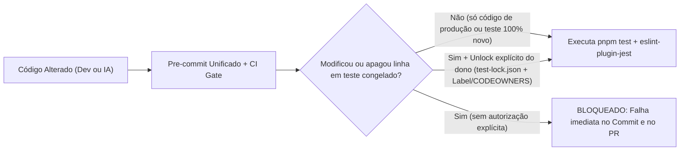

# Análise 4 — Testes em Todos os Projetos e Imutabilidade de Regras de Negócio (Spec-Lock)

Data: 2026-11-06

## 1. Resultado Executivo

Hoje apenas **3 de 10 projetos** do monorepo (`@agenda/core`, `@agenda/mobile` e `@agenda/mobile-client`) possuem script `test`, somando 80 arquivos `.test.ts` e **zero arquivos `.test.tsx`**. Os 5 apps Next.js, os 2 pacotes `shared-ui` e as 31 migrações SQL/RLS do Supabase possuem **zero testes automatizados**.

> [!CAUTION]
> ATENÇÃO: O workflow [`ci.yml`](file:///Users/titorm/git/agenda-de-boteco/.github/workflows/ci.yml#L114-L122) executa `lint`, `typecheck` e `build`, mas **não executa `pnpm run test` em Pull Requests**. Além disso, não existe nenhuma trava técnica no Git ou no CI que impeça a alteração, remoção ou `.skip` de testes existentes.

---

## 2. Diagnóstico Atual de Cobertura e Governança por Projeto

| Projeto / Camada | Manifesto / Config | Estado Atual de Testes | Lacuna Crítica Identificada |
|---|---|---|---|
| `@agenda/core` | [`jest.config.js`](file:///Users/titorm/git/agenda-de-boteco/packages/core/jest.config.js#L1-L10) (`ts-jest`) | 60 `.test.ts` (18/18 `services`, 22/23 `utils`, 5/5 `stores`, 8/18 `hooks`, 0/4 `schemas`) | `testMatch` ignora `.test.tsx`; 10 hooks e 4 schemas sem teste; [`storage.ts`](file:///Users/titorm/git/agenda-de-boteco/packages/core/src/services/storage.ts#L71-L89) não valida nem testa o teto `MAX_IMAGE_BYTES` (8 MB); [`owned-events.test.ts`](file:///Users/titorm/git/agenda-de-boteco/packages/core/src/services/owned-events.test.ts#L18) não exercita `updateError`. |
| `@agenda/mobile` | [`jest.config.js`](file:///Users/titorm/git/agenda-de-boteco/apps/mobile/jest.config.js#L1-L14) (`jest-expo`) | 13 `.test.ts` em `src/` | `testMatch` exclui toda a pasta `app/**` e exclui qualquer `.test.tsx`. |
| `@agenda/mobile-client` | [`jest.config.js`](file:///Users/titorm/git/agenda-de-boteco/apps/mobile-client/jest.config.js#L1-L14) (`jest-expo`) | 7 `.test.ts` em `src/` | `testMatch` exclui `app/**` e `.test.tsx`; formulários `EventForm` e `EstablishmentFields` sem teste. |
| `@agenda/shared-ui` | [`package.json`](file:///Users/titorm/git/agenda-de-boteco/packages/shared-ui/package.json#L14-L18) | **0 testes** (sem script `test`) | Primitivas (`DatePicker`, `TimePicker`, `Select`, `Button`, `Toast`) sem validação de erro/acessibilidade. |
| `@agenda/shared-ui-mobile` | [`package.json`](file:///Users/titorm/git/agenda-de-boteco/packages/shared-ui-mobile/package.json#L13-L17) | **0 testes** (sem script `test`) | 21 componentes (`ImagePickerField`, `ConfirmDialog`, `DatePickerField`) sem suíte. |
| `web`, `web-client`, `web-artists`, `admin`, `landing` | `apps/*/package.json` | **0 testes** nos 5 apps Next.js | Guards de rota, fluxos de login/onboarding, `formErrors.ts` locais e formulários críticos descobertos. |
| `supabase/` (RLS + RPCs) | `supabase/migrations/` (31 arquivos) | **0 testes `pgTAP`** | A fronteira real de segurança (`is_admin()`, `owns_establishment()`, policies RLS) não tem teste automatizado contra Postgres. |
| Governança CI & Git Hooks | [`ci.yml`](file:///Users/titorm/git/agenda-de-boteco/.github/workflows/ci.yml#L83-L122), [`.husky/pre-commit`](file:///Users/titorm/git/agenda-de-boteco/.husky/pre-commit#L1-L8), [`.githooks/pre-commit`](file:///Users/titorm/git/agenda-de-boteco/.githooks/pre-commit#L1-L44) | Conflito `core.hooksPath` desativa Husky; sem `eslint-plugin-jest`; sem `CODEOWNERS` | PRs passam sem rodar testes; `.skip` passa no lint; testes existentes podem ser reescritos sem bloqueio. |

---

## 3. Arquitetura Padrão de Mercado + Contrato Duplo + Imutabilidade (Spec-Lock)

### 3.1. Stack de Testes Unificada (Alinhada às Versões do Monorepo)
- **Unidade e Componentes (Todos os 10 Workspaces JS/TS):** manter **Jest `~29.7.0`** unificado (`ts-jest` no `core`, `next/jest` + `@testing-library/react@16.3.3` + `jsdom` nos 5 apps Next e `shared-ui`, e `jest-expo` + `@testing-library/react-native@14` nos 2 apps mobile e `shared-ui-mobile`). Isso evita instalar dois runners incompatíveis (`jest-expo` exige Jest) e reaproveita `@testing-library/react` já presente em [`packages/core/package.json`](file:///Users/titorm/git/agenda-de-boteco/packages/core/package.json#L35-L39).
- **Banco de Dados e Autorização RLS (`supabase/tests/`):** **pgTAP** nativo do Supabase CLI (`supabase test db`), executando em transação isolada (`BEGIN` ... `ROLLBACK`).
- **Fluxos Críticos Fim-a-Fim (E2E Web):** **Playwright** para os fluxos críticos de ponta a ponta (login/onboarding, publicação de evento, lead de artista e catálogo público), conforme recomendação oficial do Next.js 15/16.

### 3.2. Padrão Obrigatório de Escrita: Contrato Duplo (Regra de Negócio + Caminho de Erro)
Todo arquivo de teste novo ou auditado deve seguir o padrão **AAA (Arrange, Act, Assert)** dividido obrigatoriamente em dois blocos `describe` explícitos por funcionalidade:

1. **`describe('Regra de negócio: <domínio/ação>', ...)`** — valida invariantes determinísticas do produto (cálculos, limites permitidos, transições de status `draft` → `published`, payloads enviados ao Supabase, renderização esperada).
2. **`describe('Tratamento de erro: <domínio/ação>', ...)`** — valida rejeição de entradas inválidas (`ZodError`, limites excedidos como `MAX_RECURRENCE_COUNT` e `MAX_IMAGE_BYTES`), falhas de infraestrutura (rede, PostgREST, Auth, Storage, cliente nulo), bloqueio de permissão (RLS/guard) e sanitização na UI (`getFriendlyErrorMessage`, zero vazamento de SQL/PII).

### 3.3. Como Garantir Tecnicamente que Testes Não Sejam Alterados Aleatoriamente (Spec-Lock)

Para impedir que qualquer mudança de código altere o teste para "fazer o build passar", aplicam-se **quatro travas técnicas independentes**:
1. **Manifesto de Hash de Testes (`test-lock.json` + `scripts/verify-test-lock.mjs`):** grava o hash SHA-256 de cada arquivo `.test.ts`, `.test.tsx`, `.spec.ts` e `supabase/tests/*.sql`. Adicionar arquivo de teste novo é livre; editar ou apagar 1 byte de arquivo já registrado no `test-lock.json` quebra `pnpm test:verify-lock` no pre-commit e no CI. Atualizar o hash exige rodar comando manual exclusivo do humano (`pnpm test:approve-spec-change <arquivo> --reason "<motivo>"`), cujo uso autônomo por agentes de IA fica bloqueado em `AGENTS.md` e no hook.
2. **Gate de PR no GitHub (`.github/CODEOWNERS` + `spec-lock-gate.yml`):** todo PR que toque qualquer linha existente em `**/*.test.ts*`, `**/*.spec.ts*` ou `supabase/tests/**` falha automaticamente no GitHub Actions a menos que o PR receba a label restrita `spec-change-approved` aplicada pelo dono do repositório.
3. **Linter Anti-Sabotagem (`eslint-plugin-jest`):** ativa como `error` em [`eslint.config.mjs`](file:///Users/titorm/git/agenda-de-boteco/eslint.config.mjs) as regras `no-disabled-tests` (bloqueia `.skip`/`xit`), `no-focused-tests` (bloqueia `.only`), `no-commented-out-tests` e `expect-expect` (proíbe teste vazio sem asserção).
4. **Unificação de Hooks Locais:** funde [`.husky/pre-commit`](file:///Users/titorm/git/agenda-de-boteco/.husky/pre-commit) e [`.githooks/pre-commit`](file:///Users/titorm/git/agenda-de-boteco/.githooks/pre-commit) em um único pipeline ativo que valida branch protegida, `AUDIT_LOG.md` e `pnpm test:verify-lock` antes de cada commit.

---

## 4. Os Três Planos de Ação (Análise 4)

### Plano de Ação 4.1 — Blindagem Spec-Lock (Imutabilidade de Testes), CI Gate e Linter Anti-Skip

**Objetivo:** Ativar imediatamente a execução obrigatória de testes em todos os PRs e travar tecnicamente todos os 80 arquivos de teste atuais (e todos os futuros) contra edição não autorizada.

1. Adicione o passo `pnpm run test` no job `verify` de [`ci.yml`](file:///Users/titorm/git/agenda-de-boteco/.github/workflows/ci.yml#L114-L122) e configure `outputs: ["coverage/**"]` e `dependsOn: ["^build"]` na task `test` de [`turbo.json`](file:///Users/titorm/git/agenda-de-boteco/turbo.json#L33-L35).
2. Unifique [`.husky/pre-commit`](file:///Users/titorm/git/agenda-de-boteco/.husky/pre-commit) e [`.githooks/pre-commit`](file:///Users/titorm/git/agenda-de-boteco/.githooks/pre-commit) em um único diretório de hooks, removendo a sobrescrita conflitante em [`scripts/setup-hooks.bash`](file:///Users/titorm/git/agenda-de-boteco/scripts/setup-hooks.bash#L6).
3. Crie `scripts/verify-test-lock.mjs` e gere `.github/test-lock.json` com o SHA-256 dos 80 arquivos `.test.ts` existentes; configure `pnpm test:verify-lock` no pre-commit e em novo workflow `.github/workflows/spec-lock-gate.yml` (que só libera alteração/remoção em arquivos de teste existentes se a label `spec-change-approved` estiver presente no PR).
4. Crie `.github/CODEOWNERS` exigindo revisão explícita do proprietário para `**/*.test.ts`, `**/*.test.tsx`, `**/*.spec.ts`, `supabase/tests/**` e `.github/test-lock.json`.
5. Instale `eslint-plugin-jest` (com autorização prévia) e ative `no-disabled-tests`, `no-focused-tests`, `no-commented-out-tests`, `expect-expect` e `valid-expect` como `error` em [`eslint.config.mjs`](file:///Users/titorm/git/agenda-de-boteco/eslint.config.mjs), além de regra de revisão exigindo os dois blocos `Regra de negócio:` e `Tratamento de erro:` em todo novo arquivo de teste.

### Plano de Ação 4.2 — Fechamento de Lacunas em `@agenda/core`, Kits `shared-ui` e Testes RLS (`pgTAP`)

**Objetivo:** Garantir 100% de cobertura das regras de domínio, schemas, hooks, componentes compartilhados e policies SQL (sempre com par Regra de Negócio + Erro).

1. Em `@agenda/core`, amplie [`jest.config.js`](file:///Users/titorm/git/agenda-de-boteco/packages/core/jest.config.js#L5) para `['**/*.test.ts', '**/*.test.tsx']` (com `jsdom` por docblock ou projeto Jest nos hooks) e configure `coverageThreshold` mínimo bloqueante (`branches: 85`, `functions: 90`, `lines: 90`).
2. Crie suítes completas (Regra de Negócio + Tratamento de Erro) para os 4 arquivos em `packages/core/src/schemas/` (`catalog.test.ts`, `musician-lead.test.ts`, `ratings.test.ts`), para os 10 hooks sem teste em `packages/core/src/hooks/` e para `lib/queryClient.test.ts` e `supabase/client.test.ts`.
3. Corrija os gaps de código/teste já detectados no `core`: implemente e teste o bloqueio `file.size > MAX_IMAGE_BYTES` em [`storage.ts`](file:///Users/titorm/git/agenda-de-boteco/packages/core/src/services/storage.ts#L71-L89) + [`storage.test.ts`](file:///Users/titorm/git/agenda-de-boteco/packages/core/src/services/storage.test.ts); adicione teste de `updateError`, clamp de recorrência e fallback de slug em [`owned-events.test.ts`](file:///Users/titorm/git/agenda-de-boteco/packages/core/src/services/owned-events.test.ts); adicione testes de erro e `requestAccountDeletion` em [`useAuthStore.test.ts`](file:///Users/titorm/git/agenda-de-boteco/packages/core/src/stores/useAuthStore.test.ts); e adicione asserção anti-vazamento SQL/PII em [`errors.test.ts`](file:///Users/titorm/git/agenda-de-boteco/packages/core/src/utils/errors.test.ts).
4. Configure Jest em [`packages/shared-ui`](file:///Users/titorm/git/agenda-de-boteco/packages/shared-ui/package.json) (`jsdom` + `@testing-library/react` + `@testing-library/jest-dom`) e em [`packages/shared-ui-mobile`](file:///Users/titorm/git/agenda-de-boteco/packages/shared-ui-mobile/package.json) (`jest-expo` + `@testing-library/react-native`), testando todos os componentes compartilhados (caminho válido + estados `disabled`, `loading`, erro de upload e entradas inválidas).
5. Crie `supabase/tests/` com suítes **pgTAP** (`rls_establishments.test.sql`, `rls_events.test.sql`, `rls_profiles_admin.test.sql`, `rls_favorites_ratings.test.sql`, `rpcs_security_definer.test.sql`) validando para cada tabela: operação autorizada do dono/admin (**Regra de Negócio**) e bloqueio de usuário anônimo ou dono de outro bar (**Tratamento de Erro / Anti-BOLA**), executadas no CI via `supabase test db`.

### Plano de Ação 4.3 — Expansão para os 5 Apps Next.js, Rotas Mobile (`app/**`) e E2E Playwright

**Objetivo:** Eliminar o zero absoluto de testes nos 5 apps web, cobrir telas/guards mobile e blindar jornadas críticas no navegador real.

1. Nos apps [`apps/mobile/jest.config.js`](file:///Users/titorm/git/agenda-de-boteco/apps/mobile/jest.config.js#L4) e [`apps/mobile-client/jest.config.js`](file:///Users/titorm/git/agenda-de-boteco/apps/mobile-client/jest.config.js#L4), expanda `testMatch` para `['<rootDir>/{src,app}/**/*.test.{ts,tsx}']` e inclua `phosphor-react-native` e `@shopify/flash-list` em `transformIgnorePatterns`.
2. Escreva testes `.test.tsx` nos dois apps mobile para guards de autenticação/onboarding, `EventForm`, `EstablishmentFields`, `NotificationsSection` e telas de login/recuperação de senha (validando submissão válida + bloqueio de campos inválidos e erro de servidor).
3. Configure `next/jest` + `@testing-library/react` + `@testing-library/user-event` nos 5 apps Next.js (`web`, `web-client`, `web-artists`, `admin`, `landing`) adicionando script `"test": "jest"` em cada `package.json`.
4. Crie suítes de unidade/componente em cada um dos 5 apps Next.js cobrindo obrigatoriamente:
   - `web-client`: `lib/formErrors.ts`, `EventForm.tsx` (criação, rascunho, limite de 26 recorrências e falha de API), `EstablishmentFields.tsx` (ViaCEP válido vs CEP inexistente, upload PDF > 10 MB), guards `(painel)/layout.tsx` e `login/page.tsx`.
   - `web`: `useRequireAuth.ts`, filtros de eventos/cidades, `DateRangeField`, `login` e exclusão de conta.
   - `admin`: guard `is_admin`, `lib/formErrors.ts`, modais de criação/edição de bares, eventos e avisos, `PdfUpload` e `ImageUpload`.
   - `web-artists`: `MusicianForm.tsx` (envio válido + validação Zod de campos obrigatórios/WhatsApp e falha do Supabase).
   - `landing`: renderização de links de lojas/web, metadados e página de suporte.
5. Configure **Playwright** (`e2e/` na raiz com projetos isolados por porta/app) para os 4 fluxos E2E críticos de negócio (login + criação de evento no `web-client`, descoberta + favorito no `web`, captação no `web-artists` e moderação/cadastro no `admin`), congelando todas as novas especificações no `.github/test-lock.json`.
